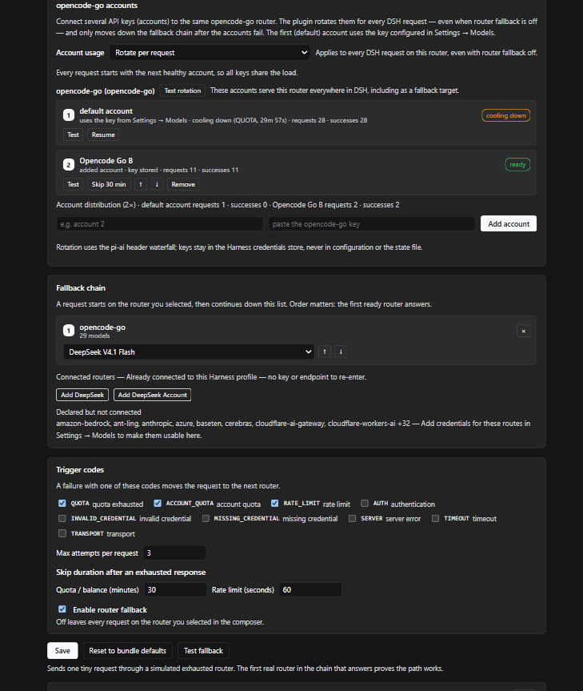

# dsh-fallback

**DeepSeek Harness(dsh / dsh-desktop)용 라우터 폴백.**

사용 중인 라우터(LLM 프로바이더 경로)가 한도나 쿼터를 소진하면 **같은 요청**을
폴백 체인의 다음 라우터로 그대로 이어서 보냅니다. API 키를 다시 입력하거나
자격 증명을 중복 저장할 필요가 없고, 앱을 재시작할 필요도 없습니다. 체인은
이 DSH 프로필에 **이미 연결된 라우터들**로 구성합니다.



## 기능

- **한도/쿼터 실패 시 자동 전환** — `QUOTA`, `ACCOUNT_QUOTA`, `RATE_LIMIT`
  실패가 나면 체인의 다음 정상 라우터로 요청을 다시 보냅니다. 어떤
  라우터도 응답하지 못할 때만 원래 실패가 대화에 표시됩니다.
- **이미 연결된 라우터 불러오기** — 프로필에 등록된 모든 프로바이더 경로
  (`opencode-go`, `opencode`, `deepseek-account`, `deepseek-official`,
  사용자 게이트웨이 등)와 각 경로의 모델 목록을 실시간으로 보여줍니다.
  체인에 추가할 때 키·주소·모델 목록을 다시 입력할 필요가 없습니다.
- **요청별 시도 체인** — 작성창에서 선택한 라우터에서 시작해 체인 아래로
  이어집니다. 순서는 패널에서 바꿀 수 있습니다.
- **한도 소진 후 건너뛰기** — 한도를 소진한 라우터는 설정된 시간 동안
  건너뛰므로 모델 스텝마다 다시 시도하지 않습니다. `RATE_LIMIT`은 짧게,
  쿼터/잔액 코드는 길게 적용하며, 프로바이더가 준 `retry-after`가 우선합니다.
- **보이는 출력 보호** — 시도가 실제 콘텐츠를 내보내기 전까지 청크를 버퍼링
  하므로, 실패한 시도가 남긴 껍데기 청크는 화면에 남지 않습니다. 콘텐츠가
  한 번 보인 뒤에는 폴백하지 않습니다(이미 기록된 메시지를 안전하게 다시
  재생할 수 없기 때문).
- **프로바이더 간 히스토리 안전 처리** — 다른 프로바이더로 넘어갈 때는
  프로바이더 전용 추론(reasoning) 블록을 히스토리에서 제거하고, 대상이 `off`
  추론 단계를 제공하면 추론을 끕니다. 다른 프로바이더의 thinking 블록이
  없다고 요청 전체가 거부되는 일을 막습니다.
- **연결 테스트** — 한도가 소진된 가상 라우터를 거쳐 아주 작은 요청을 보내고,
  체인에서 실제로 어느 라우터가 응답하는지 끝까지 검증합니다.
- **상태·기록** — 라우터 상태, 건너뛰기 남은 시간, 최근 폴백 기록, 라우터별
  요청/성공/실패 카운터를 보여줍니다.
- **dsh-desktop 지원** — 일반 Web UI 플러그인(좌측 사이드바 항목 + 전체 페이지
  + 동일 출처 JSON API)이라 데스크톱 앱과 브라우저 프런트엔드에서 동일하게
  동작합니다.

## 설치

빌드 단계도, 외부 의존성도, `@deepseek-ai` 패키지 import도 없습니다.
번들 설치가 이 디렉터리를 현재 프로필에 링크합니다.

```text
plugin_manager install_bundle  <이 디렉터리의 절대 경로>
```

또는 plugin manager가 있는 셸에서:

```text
dsh plugin install /path/to/dsh-fallback
```

처음 설치한 뒤에는 Web 셸이 새 클라이언트 모듈을 읽도록 **앱 창을 새로고침**
(또는 dsh-desktop 재시작)하세요. 이후 좌측 사이드바 패널 줄에
**Router fallback / 라우터 폴백** 항목이 나타납니다.

## 사용법

1. 사이드바에서 **라우터 폴백**을 엽니다.
2. **연결된 라우터**에서 체인에 넣을 라우터를 추가합니다. 목록은 Harness LLM
   서비스에서 실시간으로 읽어오므로 아무것도 다시 입력하지 않습니다.
3. 각 행의 모델을 고릅니다. `선택한 모델 그대로 사용`은 작성창에서 선택한
   모델 ID를 유지합니다(같은 모델을 여러 라우터가 서비스할 때 유용).
   아니면 명시적인 모델을 선택합니다.
4. 저장합니다. 다음 모델 호출부터 적용되며 진행 중인 대화는 그대로 이어집니다.
5. **폴백 테스트**를 눌러 한도 소진을 시뮬레이션하고 첫 실제 라우터가
   응답하는지 확인합니다.

요청은 작성창에서 선택한 라우터에서 시작해 체인 아래로 내려갑니다. 선택한
라우터가 체인에 없으면 먼저 시도되고, 체인은 그 폴백 목록이 됩니다. 현재
건너뛰기 중인 라우터는 건너뜁니다.

## 설정

번들 행의 `config`는 배포 기본값입니다(빈 체인, 쿼터 코드, 3회 시도). 패널에서
바꾼 값은 프로필 상태 파일에 오버라이드로 저장되므로 사용자의
`cordis.patch.yml`은 절대 다시 쓰지 않습니다.

```text
<DSH_HOME>\fallback\state.json          # 예: C:\Users\<사용자>\.dsh\fallback\state.json
```

이 파일에는 프로바이더/모델 ID, 실패 코드, 시간 값만 들어 있으며
**자격 증명은 없습니다**. 파일을 지우면 체인과 카운터가 초기화되고, 파일이
없거나 깨져 있으면 번들 기본값으로 동작합니다.

| 설정 | 기본값 | 의미 |
|---|---|---|
| 라우터 폴백 사용 | 켜짐 | 끄면 선택한 라우터로만 요청합니다. |
| 폴백 체인 | 비어 있음 | 순서대로 시도하는 라우터 목록. 먼저 정상인 라우터가 응답합니다. |
| 전환 트리거 코드 | `QUOTA`, `ACCOUNT_QUOTA`, `RATE_LIMIT` | 다음 라우터로 넘어가는 실패 코드. |
| 요청당 최대 시도 수 | 3 | 선택한 라우터를 포함한 상한. |
| 쿼터/잔액 건너뛰기 | 30분 | `QUOTA`/`ACCOUNT_QUOTA` 후 건너뛰기. 프로바이더 `retry-after`가 있으면 그 값. |
| 속도 제한 건너뛰기 | 60초 | `RATE_LIMIT` 후 건너뛰기. |

## 동작 원리

Host 절반은 `@deepseek-ai/dsh-llm`의 문서화된 확장 지점인 `llm/stream`
워터폴 리스너 하나를 붙입니다(Harness 패키지를 import하지 않습니다). 모델
호출마다 시도 목록을 계산하고, 첫 시도는 정상 어댑터 경로로 보내며, 트리거
코드로 실패했고 아직 콘텐츠가 보이지 않았을 때만
`{...요청, provider, model}`로 다시 보냅니다. 세션 로그, 스트리밍, 도구 호출,
턴 오류 처리는 모두 원래 동작 그대로입니다.

이 지점에서 폴백할 때의 알려진 결과:

- 세션에 기록되는 어시스턴트 메시지의 `source`는 **원래 선택했던**
  프로바이더/모델입니다(Harness는 요청한 경로를 기록합니다). 실제 응답한
  라우터는 패널의 이벤트 기록에 남습니다.
- 쿼터 실패는 같은 라우터에서 재시도하지 않고 즉시 전환합니다.
  `RATE_LIMIT`은 기본 Harness 재시도 집합에도 들어 있어, 폴백 가능한 체인이
  백오프보다 빠르게 응답합니다.
- 폴백도 실패할 수 있습니다(대상에 없는 모델, 컨텍스트 초과, 자격 증명 등).
  최종 실패는 프로바이더의 원래 실패이며 메시지 끝에
  `[dsh-fallback: fallback chain exhausted]`가 붙습니다.
- 쿼터/한도 계열 코드만 처리합니다. 컨텍스트 초과, 잘못된 요청, 인증 실패는
  다른 라우터에서도 똑같이 실패하므로 조용히 넘기지 않고 그대로 표시합니다.
- 일부 프로필에서 `deepseek-official`의 모델 목록이 비어 있을 수 있습니다.
  이때는 `선택한 모델 그대로 사용`으로 체인에 추가할 수 있습니다.

## 개발

순수 Node.js ESM이며 번들러와 의존성이 없습니다.

```bash
node --test --test-isolation=none "test/*.test.mjs"
```

- `lib/engine.mjs` — 시도 계획, 실패 분류, 건너뛰기 시간, 추론 히스토리 정리,
  버퍼링 스트림 러너(순수 함수, 단위 테스트).
- `lib/providers.mjs` — `llm` 서비스 기반 실시간 프로바이더/모델 탐색.
- `lib/probe.mjs` — 쿼터 프로브 어댑터와 셀프 테스트 요청.
- `lib/state.mjs` — 오버라이드/상태/이벤트 로그 영속화.
- `index.js` — Cordis 연결, 인터셉트, 셀프 테스트, HTTP API.
- `client.js` — Web UI 페이지(호스트 모듈 테이블의 일반 React 사용).

## 라이선스

MIT — [LICENSE](LICENSE) 참고.
