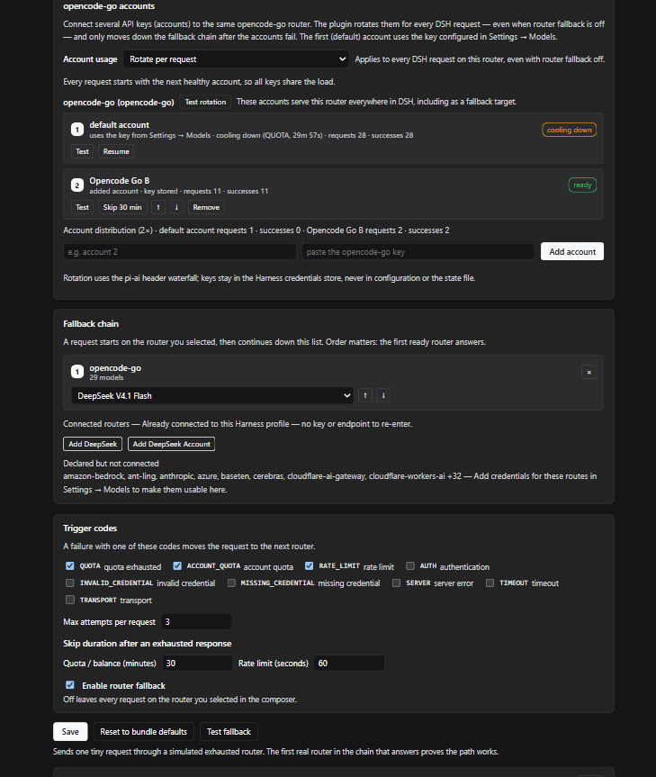

# dsh-fallback

**Router fallback for DeepSeek Harness (dsh / dsh-desktop).**

When the router (LLM provider route) the current request is using reports an
exhausted quota or limit, the *same request* continues on the next router in
your fallback chain — with no re-typed API keys, no second credential store,
and no app restart. The chain is built from the routers already connected to
your Harness profile.



## Features

- **Transparent fallback on quota/limit failures** — a request that fails with
  `QUOTA`, `ACCOUNT_QUOTA`, or `RATE_LIMIT` is re-dispatched to the next ready
  router in the chain. The terminal failure only reaches the conversation when
  no router can answer.
- **Loads the routers already connected to dsh** — the panel lists every
  provider route registered in the profile (`opencode-go`, `opencode`,
  `deepseek-account`, `deepseek-official`, custom gateways, …) together with
  each route's own model catalog. Adding a router to the chain needs no key,
  endpoint, or model list.
- **Several API accounts on one router, across DSH** — connect multiple
  `opencode-go` (or `opencode`) accounts to the same router. The plugin rotates
  the account key through the documented `llm-pi-ai/request-headers` waterfall
  for **every** DSH request on that route — including ordinary chats, subagents,
  and the route's turn as a fallback target — even when router fallback is off.
  Choose rotate-per-request (default), sticky-per-session, or priority/failover;
  an exhausted account gets its own cooldown and falls through to the next
  account before the chain moves on. Keys live in the Harness credentials store
  — never in configuration or the state file. Accounts are tested, skipped,
  resumed and reordered from the panel.
- **Per-request attempt chain** — requests start at the router you selected in
  the composer, then continue down the chain. Order is editable from the panel.
- **Cooldown after exhaustion** — a router that reported an exhausted quota is
  skipped for the rest of the configured window instead of being retried on
  every model step. `RATE_LIMIT` uses a short window, quota/balance codes use a
  longer one; a provider-supplied `retry-after` always wins.
- **Never corrupts visible output** — chunks are buffered until the first real
  content chunk of an attempt; a rejected attempt that produced only framing
  chunks leaves no trace. Fallback never happens after visible output, because
  the durable message can no longer be replayed safely.
- **Cross-provider history safety** — when an attempt moves to a different
  provider, provider-native reasoning blocks are dropped from history and
  reasoning is pinned off when the target advertises an `off` level, so a
  fallback is not rejected for missing another provider's thinking blocks.
- **Self-test** — sends one tiny request through a simulated exhausted router
  and proves, end to end, which real router in the chain answers.
- **Status and history** — router health, cooldown countdowns, the last
  fallback events, and a per-router request/success/failure counter.
- **dsh-desktop support** — the panel is a normal Web UI plugin (left-sidebar
  entry + full page + same-origin JSON API), so it works in the desktop app and
  in the browser frontend alike.

## Install

A bundle install links this directory into the running profile; no build step,
no dependencies, no `@deepseek-ai` package imports.

```text
plugin_manager install_bundle  <absolute path to this directory>
```

or from a shell with the plugin manager available:

```text
dsh plugin install /path/to/dsh-fallback
```

After the first install, **refresh the app window** (or restart dsh-desktop) so
the Web shell loads the new client module. Afterwards an entry named
**Router fallback / 라우터 폴백** appears in the left sidebar panel row.

## Use

1. Open **Router fallback** in the sidebar.
2. Under **Connected routers**, add each router you want in the chain. The list
   is read live from the Harness LLM service; nothing is re-entered.
3. Pick the model for each row. `Use the selected model` keeps the model id you
   selected in the composer (useful when the same model is served by several
   routers); otherwise choose an explicit model.
4. Save. The chain applies to the next model call — the current conversation
   keeps running.
5. Press **Test fallback** to force a simulated quota failure and confirm the
   first real router answers.

Requests start at the router selected in the composer and walk down the chain.
If the selected router is not in the chain, it is tried first and the chain is
used as its fallback list. Routes in cooldown are skipped.

### Multiple opencode-go accounts

In the **opencode-go accounts** section:

1. The first row is the **default account**: it uses the key configured in
   *Settings → Models* (`OPENCODE_GO_API_KEY` in the profile).
2. Paste another account's key and press **Add account**. The key is stored
   through the credentials service under a generated
   `DSH_FALLBACK_OPENCODE_GO_*` reference; the account joins the pool in the
   order shown (use ↑/↓ to change it).
3. Choose **Account usage**:
   - **Rotate per request** (default) — every DSH request starts on the next
     healthy account, so all keys share the load.
   - **Sticky per session** — each conversation keeps one account for prompt
     cache reuse; a new conversation takes the next account.
   - **Priority (failover)** — the first account is used until it fails.
4. **Test** sends one tiny request with that account's key. **Test rotation**
   sends two tiny requests through the ordinary request path and shows which
   account served each one. **Skip 30 min** takes an account out of rotation
   without deleting it; **Resume** puts it back.
5. The pool serves this route everywhere in DSH: normal chats, subagents, and
   the route's turn as a fallback target. Only after every healthy account has
   failed does the chain continue. If every account is cooling down, the chain
   answers (and if nothing is healthy, the first account is tried so its real
   failure is shown).

The account pool works independently of the **Enable router fallback** switch:
turning fallback off disables the chain, not the account rotation. `maxAttempts`
still caps the total attempts (accounts plus chain), so raise it when you pool
more accounts than that. Rotate-per-request gives every key an equal share; if
the provider caches prompts per key, sticky-per-session keeps cache hits while
still spreading different conversations across accounts.

Because rotation happens at the pi-ai header seam, it works for every model on
the route — including `anthropic-messages` models (`x-api-key`) and
`google-generative-ai` models (`x-goog-api-key`). The plugin reads the model →
protocol map from the pi-ai catalog shipped with the running Harness and keeps
an embedded snapshot for installations where that catalog cannot be read.

Account keys are only written to the Harness credentials store. Deleting an
account removes its key reference; the plugin never logs a key, and the state
file contains labels and references only.

## Configuration

The bundle row's `config` is the deployment default (empty chain, quota codes,
3 attempts). Everything edited from the panel is stored as overrides in the
profile's state file so the user's `cordis.patch.yml` is never rewritten:

```text
<DSH_HOME>/fallback/state.json          # e.g. C:\Users\<you>\.dsh\fallback\state.json
```

The file contains provider/model ids, failure codes and timings — **no
credentials**. Deleting it resets the chain and all counters; a malformed or
missing file simply falls back to the bundle defaults.

| Setting | Default | Meaning |
|---|---|---|
| Enable router fallback | on | Off disables the chain; pooled accounts still rotate. |
| Fallback chain | empty | Ordered routers; first ready one answers. |
| Account usage | rotate per request | How pooled keys are chosen: rotate, sticky per session, or priority/failover. |
| Trigger codes | `QUOTA`, `ACCOUNT_QUOTA`, `RATE_LIMIT` | Failures that move the request to the next router. |
| Max attempts per request | 3 | Hard cap including the selected router. |
| Quota/balance skip | 30 min | Cooldown after `QUOTA`/`ACCOUNT_QUOTA`, unless the provider reports `retry-after`. |
| Rate-limit skip | 60 s | Cooldown after `RATE_LIMIT`. |

## Security and privacy

- The settings API is served on loopback and is checked by DSH's connection
  trust service (Host/Origin validation and browser authentication). It accepts
  only same-origin JSON POSTs carrying the plugin's request marker; expensive
  test endpoints are single-flight.
- Added account keys are stored through the Harness credentials service, never
  in the plugin configuration, state file, logs or API responses. The state file
  keeps labels, credential references, counters and hashed session tags only.
  Stored error messages redact provider URLs, organization ids and key-shaped
  tokens; paths returned by the API redact the home directory.
- The credentials store itself is owned by DSH. Depending on the release it may
  be protected by OS access control rather than encrypted at rest; protect the
  profile directory and do not sync it to untrusted storage. See
  [SECURITY.md](SECURITY.md).
- Fallback routes and pooled-provider accounts receive the request content by
  design. Review the chain before routing sensitive conversations through
  third-party routes.

## How it works

The Host half attaches one `llm/stream` waterfall listener (a documented,
interceptable seam of `@deepseek-ai/dsh-llm`; the plugin imports no Harness
package). For each model call it plans the attempt list, dispatches the first
attempt through the normal adapter path, and only re-dispatches
`{...request, provider, model}` when the attempt failed with a trigger code
*before* any content became visible. Everything else — session log, streaming,
tool calls, turn errors — is the shipped behavior.

Pooled accounts are an attempt dimension on the same route, applied to the
selected route and to every chain route that supports accounts. Before each
call the pool orders its healthy accounts — round-robin, sticky per session, or
the configured priority — and each attempt carries its own health key, followed
by the chain. Each attempt's key is carried into
`llm-pi-ai/request-headers` through Node's async-local storage, because that
waterfall receives only routing metadata. Writing the protocol's auth header
there overrides the route's configured key for that request only (verified
against the live pi-ai adapter: a wrong contributed key fails with `AUTH`).

Known consequences of doing this at the LLM seam:

- The durable assistant message keeps the **originally selected** provider/model
  as its source (the Harness records the requested route, not the answering
  one). The panel's event log records the actual answering router.
- Quota failures are not retried on the same route first: the plugin switches
  immediately. `RATE_LIMIT` is also in the default Harness retry set, so a
  fallback-capable chain answers faster than the retry backoff.
- A fallback can still fail (invalid model on the target, context window,
  credentials). The final failure is the provider's own, with a
  `[dsh-fallback: fallback chain exhausted]` suffix on the message.
- Only quota/limit-style codes are handled. Context-overflow, invalid-request
  and auth failures are surfaced, not silently moved, because another router
  would fail the same way. Add `AUTH` to the trigger codes if an invalid
  account key should fall through to the next account/router instead.
- Account pooling is offered for `opencode-go` and `opencode`; the underlying
  key override works for any pi-ai route, but the panel intentionally limits
  the list. Model → protocol mapping prefers the installed pi-ai catalog and
  falls back to an embedded snapshot; an unknown model is assumed
  OpenAI-compatible (`authorization: Bearer`).
- `deepseek-official` may advertise no model catalog in some profiles; it can
  still be added with `Use the selected model`.

## Development

Pure Node.js ESM; no bundler and no dependencies.

```bash
node --test --test-isolation=none "test/*.test.mjs"
```

- `lib/engine.mjs` — attempt planning, failure classification, cooldowns,
  reasoning-history sanitization, the buffering stream runner (pure, unit
  tested).
- `lib/accounts.mjs` — the pooled-account model, credential references and
  validation.
- `lib/rotation.mjs` — rotate/sticky/failover account ordering (pure, unit
  tested).
- `lib/providers.mjs` — live provider/model discovery over the `llm` service.
- `lib/probe.mjs` — the quota probe adapter and self-test request.
- `lib/state.mjs` — durable overrides, health and event log.
- `index.js` — Cordis wiring, interception, self-test, HTTP API.
- `client.js` — the Web UI page (plain React from the host module table).

## License

MIT — see [LICENSE](LICENSE).
